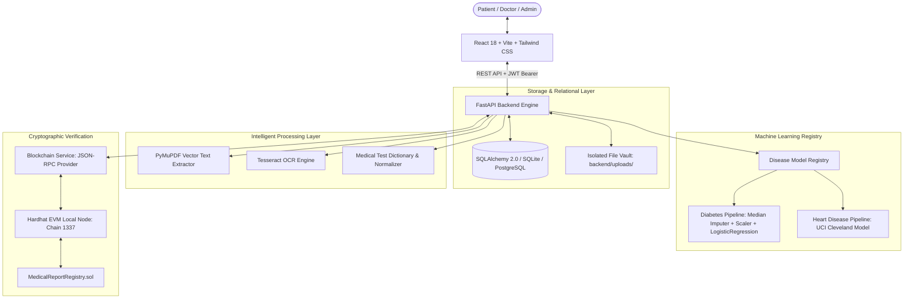

# AI-Powered Medical Report Management & Multi-Disease Risk Prediction System with Blockchain Verification

[](https://www.python.org/)
[](https://fastapi.tiangolo.com/)
[](https://react.dev/)
[](https://tailwindcss.com/)
[](https://soliditylang.org/)
[](https://scikit-learn.org/)
[](https://opensource.org/licenses/MIT)

> **B.Tech Computer Engineering (AI & ML) Major Project**  
> An enterprise-grade, end-to-end full-stack healthcare platform combining intelligent document OCR, dual machine learning risk assessment pipelines, granular physician consent management, and immutable SHA-256 blockchain verification.

---

## 📌 Key Architectural Pillars

1. **Authentication & Role-Based Access Control (RBAC):** Strict backend enforcement across three distinct roles: **Patient**, **Doctor**, and **Admin**.
2. **Medical Report Storage & Vault:** Encrypted, secure filesystem storage outside public web roots with SHA-256 integrity checksums.
3. **Dual-Mode OCR Pipeline:** PyMuPDF text block extraction for digital PDFs with Tesseract OCR fallback for scanned lab documents.
4. **Medical Biomarker Normalization:** Configurable alias dictionary mapping variations (e.g. *FBS*, *Fasting Glucose*) to canonical feature keys with unit normalization (mmol/L ➔ mg/dL).
5. **Multi-Disease ML Model Registry:** Centralized, scikit-learn preprocessing and inference pipelines for **Type 2 Diabetes** and **Coronary Heart Disease** with data provenance tracking.
6. **Hardhat Blockchain Verification:** Solidity smart contract (`MedicalReportRegistry.sol`) anchoring report SHA-256 digests. Strictly zero PII or medical data on-chain.
7. **Doctor Sharing & Patient Sovereignty:** Time-bounded, granular physician access with instant revocation capabilities.
8. **Audit Logging & Governance:** Cryptographic audit trail logging all uploads, OCR modifications, inferences, and sharing events.

---

## 🏗️ System Architecture



---

## 🔬 Machine Learning Evaluation Summary

Models were rigorously trained using **5-Fold Stratified Cross-Validation** with leakage-safe pipelines:

| Model Target | Algorithm | Dataset Cohort | Accuracy | Precision | Recall (Sensitivity) | F1-Score | ROC-AUC |
| :--- | :--- | :--- | :---: | :---: | :---: | :---: | :---: |
| **Type 2 Diabetes** | Logistic Regression | Pima Indians Diabetes (NIDDK) | **70.78%** | 60.00% | 50.00% | 0.5455 | **0.8130** |
| **Coronary Heart Disease** | Logistic Regression | UCI Cleveland Clinic Foundation | **86.89%** | 81.25% | **92.86%** | **0.8667** | **0.9513** |

*All biological zeros (e.g. Glucose=0, BloodPressure=0) are treated as missing data and imputed using median statistics fitted strictly on training folds.*

---

## 📁 Project Directory Layout

```
├── backend/
│   ├── app/
│   │   ├── api/v1/          # REST endpoints (auth, reports, extraction, predictions, blockchain, sharing, admin)
│   │   ├── core/            # Config, direct bcrypt security, JWT, dependencies
│   │   ├── database/        # SQLAlchemy engine, session, Base
│   │   ├── models/          # 11 SQLAlchemy models (User, Report, ExtractedValue, Prediction, etc.)
│   │   ├── schemas/         # Pydantic v2 validation schemas
│   │   └── services/        # Service layer (Reports, Extraction, Registry, Blockchain, Sharing, Admin)
│   ├── ml/
│   │   ├── artifacts/       # Serialized models (.joblib) & metadata (.json)
│   │   ├── datasets/        # Benchmark CSVs (diabetes.csv, heart_disease.csv)
│   │   └── training/        # Training & cross-validation scripts
│   ├── tests/               # 17 comprehensive pytest test suites
│   └── requirements.txt     # Python dependencies
├── blockchain/
│   ├── contracts/           # MedicalReportRegistry.sol
│   ├── scripts/             # Hardhat deployment script (deploy.js)
│   ├── test/                # Hardhat Chai tests (registry.test.js)
│   └── hardhat.config.js    # Hardhat network configuration
├── frontend/
│   ├── src/
│   │   ├── components/      # UI components & route guards
│   │   ├── pages/           # Patient, Doctor, Admin, and Public pages
│   │   ├── services/        # Axios API client modules
│   │   └── App.tsx          # Full client routing table
└── docs/presentation/       # Viva Voce questions & examination preparation
```

---

## 🚀 Quickstart & Setup Guide

### 1. Prerequisites
- Python 3.10+ (Tested on Python 3.14)
- Node.js & npm (Optional for local frontend dev server & Hardhat node)

### 2. Backend Setup
```bash
# Navigate to backend
cd backend

# Create & activate virtual environment
python -m venv venv
# On Windows:
venv\Scripts\activate
# On Linux/macOS:
source venv/bin/activate

# Install dependencies
pip install -r requirements.txt

# Seed the default administrative user
python scripts/seed_admin.py

# Start the FastAPI server
uvicorn app.main:app --host 127.0.0.1 --port 8000 --reload
```
The interactive Swagger API documentation will be available at:  
👉 **http://127.0.0.1:8000/docs**

### 3. Running Backend Tests
Execute the comprehensive automated test suite (17/17 passing):
```bash
# From workspace root:
$env:PYTHONPATH='backend'
backend\venv\Scripts\pytest.exe backend/tests/ -v
```

### 4. Smart Contract Blockchain Setup
```bash
cd blockchain
npm install
npm test
npm run deploy:local
```

### 5. Frontend Setup
```bash
cd frontend
npm install
npm run dev
```
Open **http://localhost:5173** in your browser.

---

## 🔑 Pre-Seeded Default Accounts

| Role | Email Address | Password | Permissions |
| :--- | :--- | :--- | :--- |
| **System Admin** | `admin@medicalai.local` | `Admin@123456` | Complete system metrics, user toggling, audit trails |
| **Test Patient** | `patient1@example.com` | `Password@123` | Upload reports, run predictions, blockchain verification |
| **Test Physician** | `dr_smith@example.com` | `Doctor@123` | View patient-authorized reports & prediction history |

---

## ⚖️ Clinical & Ethical Disclaimer

> **IMPORTANT MEDICAL NOTICE:**  
> This system is developed strictly for **educational, academic evaluation, and research demonstration purposes**. The machine learning models and predictive scores generated by this platform are statistical outputs trained on benchmark cohorts. They do **not** constitute medical diagnoses, treatment plans, or formal healthcare recommendations. Always consult a qualified, licensed medical professional for personal clinical advice.
